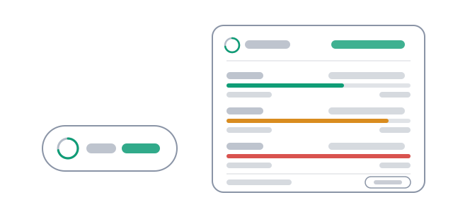

# dsh-opencode-go-usage

An [OpenCode Go](https://opencode.ai) quota capsule for [DeepSeek Harness](https://github.com/deepseek-ai/deepseek-harness): one small capsule under the composer with the room left in the tightest Go window, and a click-open panel with the 5-hour, weekly and monthly windows.



## What it does

- **The capsule** joins `conversation.composer.dock`, the row below the composer, beside the shipped activity and usage readings. It shows a ring plus the remaining percentage of the tightest window; orange from 25% left, red when a window is exhausted or the gateway reports a limit.
- **The panel** opens above the capsule on click. Per window it shows used and remaining percentages, a bar, the reset time with a countdown to the second, and any non-`ok` status. **Refresh** re-reads the endpoint past the cache, and the reading age is shown before it.
- **The tool** `opencode_go_usage` gives the assistant the same numbers, so "how much Go quota is left?" is answered without the user opening anything.

Readings come from the gateway's own endpoint, `GET https://opencode.ai/zen/go/v1/usage`, authenticated with the key that `OPENCODE_GO_API_KEY` names. That is the credential the `opencode-go` model provider in the same profile already uses, so the plugin never asks for a key of its own, and a reading does not consume quota.

Without a configured key the capsule stays hidden — no placeholder for people who do not use Go. Polling keeps running, so it appears as soon as a key is added.

## Install

Install it as a bundle in the running profile, the way any bundle is installed: **Settings → Plugins** in the DSH Web GUI accepts this package by directory, Git URL or published name. The `dsh plugin` CLI drives the same installer (`dsh plugin --help`).

For a checkout, the simplest form is a path:

```sh
# in the profile that should run it
dsh plugin --profile desktop install /absolute/path/to/dsh-opencode-go-usage
```

If you prefer a hand-written profile layer, insert the package by path in the profile's `cordis.patch.yml` instead — this needs no dependency entry:

```yaml
- insert:
    - id: opencode-go-usage
      name: '/absolute/path/to/dsh-opencode-go-usage'
      config:
        apiKeyEnv: OPENCODE_GO_API_KEY
```

Reload the page after installing or editing `client.js`; the Host half reloads through HMR when the profile watches the directory.

### Install from the plugin market

`market/index.json` is a [format-1 plugin-market index](https://github.com/deepseek-ai/deepseek-harness) for this package. Add

```
https://raw.githubusercontent.com/saltyfishtree/dsh-opencode-go-usage/main/market/index.json
```

as an index source in the plugin market's Discover tab to browse and install the bundle there. Each listed version pins the commit it was validated at.

### Prerequisites

- A Go subscription and a key from the OpenCode console, configured as the `OPENCODE_GO_API_KEY` credential (Settings → Models, or the environment).
- A DSH Host with the Web carrier — Web or Desktop. A Hostless profile has no browser capsule; the tool still works.

## Configuration

Set these under the row's `config`. All fields are optional.

| Field | Default | Meaning |
|---|---|---|
| `apiKeyEnv` | `OPENCODE_GO_API_KEY` | Credential reference resolved with the `credentials` service on every read. |
| `endpoint` | `https://opencode.ai/zen/go/v1/usage` | Usage endpoint. |
| `cacheSeconds` | `30` | How long one reading serves page polls and tool calls. |
| `staleSeconds` | `900` | How long the last good reading keeps serving after a failed request, marked stale. |
| `timeoutMs` | `8000` | Request timeout. |

## What leaves the machine

One `GET` to the configured endpoint, with your key in an `Authorization: Bearer` header, at most once per `cacheSeconds` and only while a DSH page or the tool asks for it. The response — three window percentages and reset instants — is kept in Host memory only; nothing is written to disk and nothing is sent anywhere else.

## Limits

- The endpoint reports percentages only. Exact dollar amounts live in the [OpenCode console](https://opencode.ai/console); this plugin does not guess them.
- Window names and the `rolling` / `weekly` / `monthly` shape come from the gateway; a changed response is reported as `invalid-response` instead of an empty capsule.
- A `429`-style limit is shown as the window's `status`; the plugin does not retry a limited window on its own schedule.

## Development

Plain ESM and plain browser JavaScript — no build step, no dependencies:

```
index.js            Host half: cached reader, browser route, agent tool
client.js           browser half: dock capsule and panel
cordis.patch.yml    the bundle row
locale/{en,zh}.json plugin-manager display metadata
icon.svg            plugin icon
docs/               detail documents and their one preview image
```

`node --check index.js client.js` covers syntax. Because the browser half is served from these files, editing `client.js` and reloading the page is the whole loop.

## License

MIT
