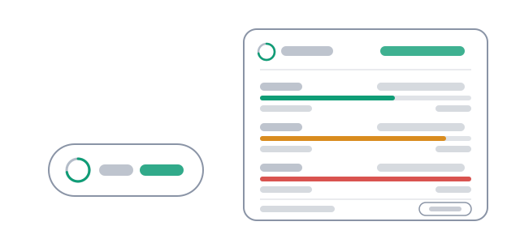

# dsh-opencode-go-usage

[DeepSeek Harness](https://github.com/deepseek-ai/deepseek-harness) 的 [OpenCode Go](https://opencode.ai) 用量胶囊：对话框下方一个小胶囊，显示 Go 三档窗口里剩余最少的额度；点开后是 5 小时、本周、本月三档的完整面板。



## 功能

- **胶囊**加入 `conversation.composer.dock`，也就是对话框下方那一行，和内置的活动、用量读数并列。它用一个圆环加百分比显示最紧张的那档窗口还剩多少；剩余 25% 以下转橙，某一档用尽或网关报告限制时转红。
- **面板**点击后在胶囊上方展开。每一档窗口显示已用与剩余百分比、进度条、重置时间以及精确到秒的倒计时，还有非 `ok` 的状态。**刷新**会绕过缓存重新读取，下方同时显示这次读数的时长。
- **工具** `opencode_go_usage` 把这组数字交给助手，因此「Go 还剩多少」不用打开面板也能回答。

读数来自网关自己的接口 `GET https://opencode.ai/zen/go/v1/usage`，使用 `OPENCODE_GO_API_KEY` 指向的密钥——正是同一配置里 `opencode-go` 模型提供方已经在用的那把，插件不再单独要密钥；读取本身不消耗额度。

没有配置密钥时胶囊保持隐藏，不会给不用 Go 的人留一个占位符。轮询仍在继续，配上密钥后它就会出现。

## 安装

作为一个 bundle 装进正在运行的 profile：在 DSH Web GUI 的**设置 → 插件**里按目录、Git 地址或已发布名称添加；`dsh plugin` 命令行驱动的是同一个安装器（`dsh plugin --help`）。

以本地检出为例，最直接的方式是用路径：

```sh
dsh plugin --profile desktop install /absolute/path/to/dsh-opencode-go-usage
```

也可以手写 profile 层，在 `cordis.patch.yml` 里按路径插入，这样不需要依赖条目：

```yaml
- insert:
    - id: opencode-go-usage
      name: '/absolute/path/to/dsh-opencode-go-usage'
      config:
        apiKeyEnv: OPENCODE_GO_API_KEY
```

安装或改动 `client.js` 后刷新页面即可；如果 profile 监听了该目录，Host 半会通过 HMR 就地重载。

### 从插件市场安装

`market/index.json` 是本包的 format-1 插件市场索引。把

```
https://raw.githubusercontent.com/saltyfishtree/dsh-opencode-go-usage/main/market/index.json
```

作为索引源加到插件市场的 Discover 标签页，就能在那里浏览并安装这个 bundle。每个列出的版本都钉在它通过校验时的那个提交上。

### 前提

- 有 Go 订阅，并在 OpenCode 控制台取得密钥，配置为 `OPENCODE_GO_API_KEY` 凭据（设置 → 模型，或环境变量）。
- 宿主带 Web 载体（Web 或桌面版）。无宿主的 profile 没有浏览器胶囊，工具仍然可用。

## 配置

写在行的 `config` 下，全部可选。

| 字段 | 默认值 | 含义 |
|---|---|---|
| `apiKeyEnv` | `OPENCODE_GO_API_KEY` | 每次读取时通过 `credentials` 服务解析的凭据引用。 |
| `endpoint` | `https://opencode.ai/zen/go/v1/usage` | 用量接口。 |
| `cacheSeconds` | `30` | 一次读数供页面轮询和工具调用复用的时长。 |
| `staleSeconds` | `900` | 请求失败后，最后一次成功读数继续服务的时长，并标记为过期。 |
| `timeoutMs` | `8000` | 请求超时。 |

## 会离开本机的数据

一次 `GET`，发往配置的接口，密钥放在 `Authorization: Bearer` 头里；最多每 `cacheSeconds` 一次，且只在实际有页面或工具需要时发出。返回值——三档窗口的百分比与重置时刻——只保留在宿主内存中，不落盘，也不发往别处。

## 限制

- 接口只给百分比。精确金额在 [OpenCode 控制台](https://opencode.ai/console)，本插件不做推测。
- 窗口名称与 `rolling` / `weekly` / `monthly` 的结构来自网关；响应结构变化时报 `invalid-response`，而不是显示一个空胶囊。
- 被限流的窗口按窗口的 `status` 展示；插件不会自己安排重试节奏。

## 开发

纯 ESM 与纯浏览器 JavaScript——无需构建，没有依赖：

```
index.js            Host 半：缓存读取、浏览器路由、助手工具
client.js           浏览器半：胶囊与面板
cordis.patch.yml    bundle 行
locale/{en,zh}.json 插件管理器的显示元数据
icon.svg            插件图标
docs/               详情文档及其唯一一张预览图
```

`node --check index.js client.js` 覆盖语法检查。浏览器半直接从这些文件提供，所以改 `client.js` 再刷新页面就是全部循环。

## 许可

MIT
